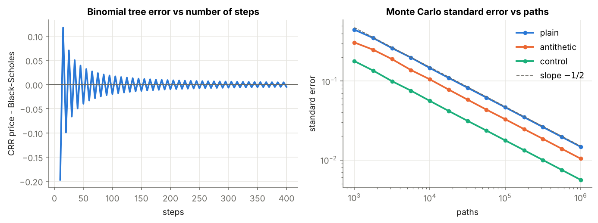
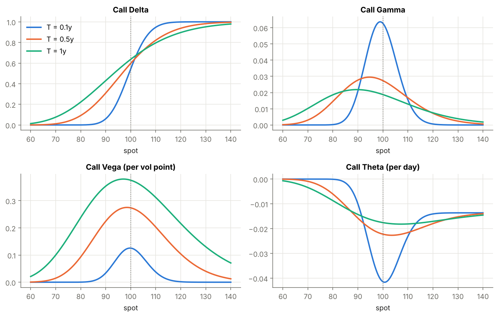
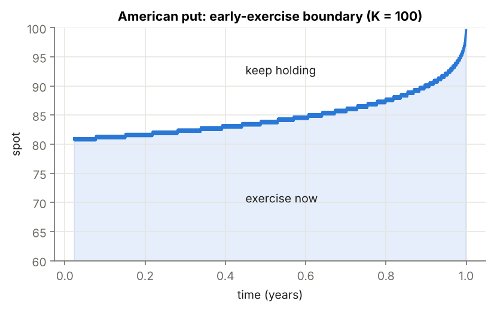
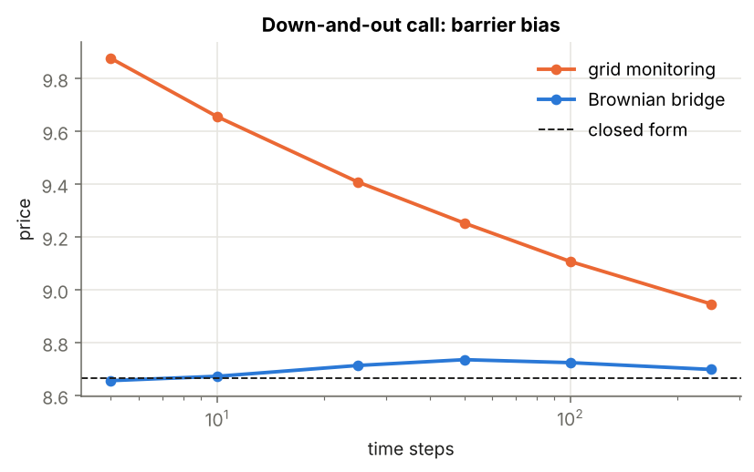
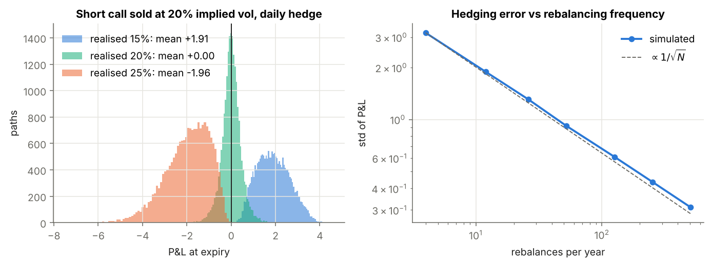
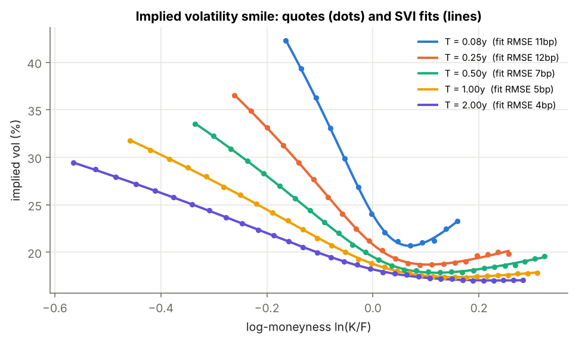

# Option Pricing Engine

A tested option pricing library in Python, with a multithreaded C++ core. It prices European, American and exotic options with four independent methods and cross-checks them against each other. On top of that it calibrates an implied-volatility surface and simulates the P&L of delta hedging.

  

**Highlights**
- **Four independent pricing methods that agree:** closed-form Black-Scholes, a Cox-Ross-Rubinstein tree and Crank-Nicolson finite differences agree to within 0.001, and Monte Carlo lands inside its confidence interval.
- **Variance reduction:** a geometric-Asian control variate divides the Monte Carlo standard error of an arithmetic Asian option by **36**.
- **Barrier options:** a Brownian-bridge correction removes the **+6% bias** of grid-monitored barrier simulation.
- **Delta-hedging simulator:** it reproduces the gamma-P&L formula ½ Γ S² (σ²ᵢₘₚ − σ²ᵣₑₐₗ) to within **0.2%**, and shows hedging error decaying like 1/√N.
- **Volatility surface:** an SVI calibration per maturity, with a butterfly-arbitrage check.
- **C++17 engine:** 17 million options per second with full Greeks, and a multithreaded Monte Carlo that prices 50 million paths in 0.6 s on 2 cores.

## Contents

| Module | What it does |
|---|---|
| `pricer.black_scholes` | Vectorised prices and analytic Greeks (Δ, Γ, vega, Θ, ρ) with dividend yield; digital, down-and-out barrier and geometric Asian closed forms |
| `pricer.implied_vol` | Implied volatility by Newton-Raphson with a bisection safeguard; vectorised; rejects prices outside no-arbitrage bounds |
| `pricer.binomial` | CRR tree, European and American, tree delta and gamma, early-exercise boundary |
| `pricer.monte_carlo` | European with plain / antithetic / control-variate estimators and confidence intervals; pathwise delta; arithmetic Asian with a geometric control variate; down-and-out barrier with Brownian-bridge correction |
| `pricer.pde` | Crank-Nicolson on log-spot with Rannacher smoothing, O(N) tridiagonal solves, American exercise by projection |
| `pricer.hedging` | Discrete delta-hedging of a short call under a misspecified volatility, with transaction costs |
| `pricer.vol_surface` | Implied vols from an option chain, SVI fit per maturity, Gatheral's butterfly-arbitrage check |
| `cpp/` | Header-only C++17 Black-Scholes, Greeks, implied vol, multithreaded Monte Carlo; tests and benchmark |

## Results

Base case: S = K = 100, r = 5%, σ = 20%, T = 1 year, no dividends. All numbers are reproduced by `python examples/make_figures.py`.

| Instrument and method | Price | Std. error | Time |
|---|---:|---:|---:|
| European call, Black-Scholes closed form | 10.4506 |  |  |
| European call, CRR tree (2,000 steps) | 10.4496 |  | 45 ms |
| European call, Crank-Nicolson PDE (400×400) | 10.4500 |  | 18 ms |
| European call, Monte Carlo + control variate (1M paths) | 10.4493 | 0.0056 | 37 ms |
| European put, Black-Scholes | 5.5735 |  |  |
| American put, CRR tree (2,000 steps) | 6.0900 |  |  |
| American put, PDE with early exercise | 6.0894 |  |  |
| Asian call (12 fixings), plain MC | 6.1644 | 0.0190 |  |
| Asian call, geometric control variate | 6.1557 | 0.0005 |  |
| Down-and-out call (H = 90), closed form | 8.6655 |  |  |
| Down-and-out call, MC grid monitoring (biased) | 9.2077 | 0.0233 |  |
| Down-and-out call, MC + Brownian bridge | 8.6936 | 0.0229 |  |
| Hedged short call, implied 25% / realised 18%: simulated mean P&L | 2.7666 | 0.0068 |  |
| Same, gamma P&L theory | 2.7699 |  |  |

Over 100 seeds, (MC − exact) / std. error has mean 0.00 and standard deviation 0.98, which is what an unbiased estimator with correct error bars should give.

### Convergence
The binomial tree oscillates as it converges, a known odd/even effect of CRR. Monte Carlo error falls like 1/√n, and the control variate cuts it about 2.5× at no extra cost.



### Greeks
Gamma and theta concentrate at the money as expiry nears; vega is largest for long-dated at-the-money options.



### American put
The early-exercise premium is 0.52: the American put is worth 6.09, the European one 5.57. When the spot falls below the boundary, exercising immediately is optimal.



### Barrier options: why the Brownian bridge matters
Checking the barrier only at simulation dates misses paths that cross between dates, so knock-out options are overpriced. The bridge correction removes the bias at any step size.



### Delta hedging
**Left:** a call sold at 20% implied volatility and hedged daily makes money when realised volatility comes in lower, and loses when it comes in higher. **Right:** with correct volatility, the hedging error comes only from discrete rebalancing and shrinks like 1/√N.



### Implied volatility surface
SVI fits on a **synthetic** equity-index chain (`data/chain_synthetic.csv`, generated by `scripts/make_synthetic_chain.py` with realistic skew and bid-ask noise). To use real market data, run `python scripts/fetch_chain.py SPY` (needs `yfinance` and internet).



### C++ benchmark
On a 2-core cloud VM, `-O3`:
```
Closed form: 10,000,000 options (price + 5 Greeks) in 0.58 s -> 17.2 M options/s
Monte Carlo, 1 thread : 50,000,000 paths in 1.08 s, price 10.45179 +/- 0.00288
Monte Carlo, 2 threads: 50,000,000 paths in 0.60 s, price 10.45027 +/- 0.00288
```

## Quick start

```bash
pip install -e ".[dev]"
pytest -q                              # 29 tests
python examples/make_figures.py        # regenerate figures and docs/results.md

# C++
cmake -S cpp -B cpp/build -DCMAKE_BUILD_TYPE=Release && cmake --build cpp/build -j
./cpp/build/test_pricer && ./cpp/build/benchmark
```

```python
from pricer import black_scholes as bs, implied_vol, binomial, monte_carlo as mc

bs.price(100, 100, 1.0, 0.05, 0.2, kind="call")              # 10.4506
bs.greeks(100, 100, 1.0, 0.05, 0.2)["delta"]                  # 0.6368
implied_vol.implied_vol(10.4506, 100, 100, 1.0, 0.05)        # 0.2000
binomial.crr_price(100, 100, 1.0, 0.05, 0.2, kind="put", american=True, steps=2000).price  # 6.0900
mc.asian_arithmetic_call(100, 100, 1.0, 0.05, 0.2, n_fixings=12)  # MCResult(price=6.155..., stderr=0.0005...)
```

## How correctness is tested
Every method is checked against an independent one, not against itself:
- **Closed form:** textbook reference values (Hull), put-call parity, all Greeks against finite differences, the Black-Scholes PDE identity Θ + ½σ²S²Γ + rSΔ − rV = 0, and no-arbitrage bounds with convexity in strike.
- **Implied vol:** round trips from 8% to 120% volatility; rejects arbitrage-violating prices.
- **Numerical methods:** the tree and the PDE converge to Black-Scholes; the American call equals the European call without dividends; the tree and the PDE agree on the American put.
- **Monte Carlo:** the closed form lies inside the confidence interval for all three estimators; the control variate halves the error; the barrier bias is detected and removed.
- **Hedging:** P&L standard deviation scales like 1/√N; the mean P&L matches gamma theory within 5%.
- **SVI:** recovers known parameters exactly; the fitted slices pass the butterfly test.

The C++ library has its own test executable, and GitHub Actions runs both suites on every push.

## Theory notes
- **Black-Scholes.** Under the risk-neutral measure, dS = (r − q) S dt + σ S dW. A call is worth S e^{−qT} N(d₁) − K e^{−rT} N(d₂).
- **CRR tree.** u = e^{σ√Δt}, d = 1/u, p = (e^{(r−q)Δt} − d)/(u − d). American value = max(continuation, exercise).
- **Crank-Nicolson.** θ = ½ is second order in time, but the payoff kink creates spurious oscillations near the strike. A few fully implicit steps (Rannacher, 1984) damp them.
- **Control variates.** The estimator h − β(g − E[g]) with β = Cov(h, g)/Var(g) cuts variance by a factor 1 − ρ². The geometric Asian has a closed form and is very highly correlated with the arithmetic one (Kemna and Vorst, 1990).
- **Brownian bridge.** Given the endpoints a and b (log-distance to the barrier) of a step, the probability of crossing in between is exp(−2ab/(σ²Δt)).
- **Hedging P&L.** A short option hedged at implied volatility σᵢ earns about ∫ ½ e^{r(T−t)} Γ S² (σᵢ² − σᵣ²) dt. That is why option desks are said to trade volatility, not direction.
- **SVI.** Total variance w(k) = a + b(ρ(k − m) + √((k − m)² + s²)) (Gatheral, 2004).

## Possible extensions
Heston stochastic volatility with Fourier pricing, a local volatility surface (Dupire), Longstaff-Schwartz regression for American Monte Carlo, Python bindings for the C++ core (pybind11), and quasi-Monte Carlo with Sobol sequences.

## References
Hull, *Options, Futures, and Other Derivatives* · Glasserman, *Monte Carlo Methods in Financial Engineering* · Gatheral, *The Volatility Surface* · Wilmott, *Paul Wilmott Introduces Quantitative Finance*.

## License
MIT
